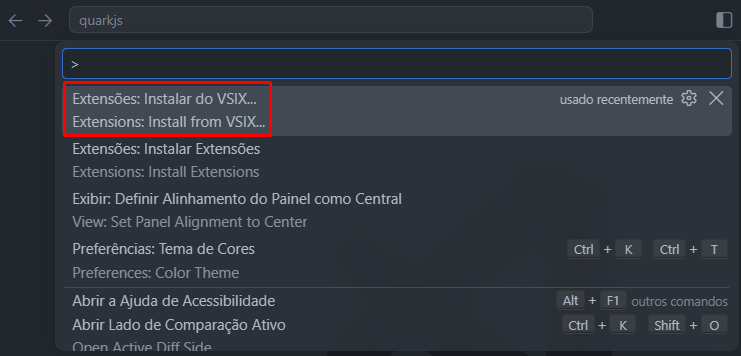
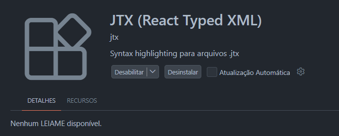

# QuarkJS

-red>)

A language that is simple to understand, easy to use, and practical for building React applications. Its files use the `.jtx` extension (**`JavaScript Typed XML`**) and are compiled to `.jsx` or `.tsx`.

## Structure

QuarkJS uses just 2 modules: the **JTX** module and the **Builderman** module. The **JTX** module translates all the syntax and functions of `.jtx` files, while **Builderman** uses some of JTX's functions to build all `.jtx` files into `.jsx`/`.tsx`.

## How to install

Type this row in your terminal:

```shell
npm i -g @arthurferreira-dev/quarkjs
```

And if you go compile your .jtx files, type this other row:

```shell
quarkjs
```

## Features

### `use` instead of `import`

```jtx
use { Heart } from "lucide-react"
```

Becomes:

```jsx
import { Heart } from "lucide-react";
```

### `default` instead of `export default function`

```jtx
default App() {
  return (
    <div>
      <Heart />
    </div>
  )
}
```

Becomes:

```jsx
export default function App() {
  return (
    <div>
      <Heart />
    </div>
  );
}
```

Without `default`, the function becomes a named export:

```jtx
App() {
  return (
    <div>
      <Heart />
    </div>
  )
}
```

Becomes:

```jsx
export function App() {
  return (
    <div>
      <Heart />
    </div>
  );
}
```

If you don't want a named export, use the `@no-export` decorator right above the function:

```jtx
@no-export
App() {
  return (
    <div>
      <Heart />
    </div>
  )
}
```

Becomes:

```jsx
function App() {
  return (
    <div>
      <Heart />
    </div>
  );
}
```

Features such as self-closing tags keep working normally.

## One-word hooks

| React hook       | JTX hook | How to use                  |
| ---------------- | -------- | --------------------------- |
| useState         | state    | state name, setName = value |
| useRef           | ref      | ref element = value         |
| useId            | id       | id name                     |
| useDeferredValue | deferred | deferred name = value       |
| useContext       | context  | context name = ThemeContext |

> **_Hooks such as useEffect and useMemo don't exist in JTX yet_**

## Native Features

### Shared State: `share`

`share` is an alternative to Zustand, letting you share any state natively, without installing dependencies, with just one word.

```jtx
share items, setItems = [] // any primitive type can be assigned to it
```

See the following example:

```jtx
@path="store/shared.js"
share items, setItems = false

@path="test/Test.jsx"
Test() {
  return (
    <div>
      <button onClick={() => setItems(!items)}>Has items?</button>
      <p>{items ? "There are items in the list!" : "There are no items in the list!"}</p>
    </div>
  );
}
```

`store/shared.js`:

```js
const items$store = { value: false, listeners: new Set() };
export const getItems = () => items$store.value;
export const setItems = (next) => {
  items$store.value =
    typeof next === "function" ? next(items$store.value) : next;
  items$store.listeners.forEach((listener) => listener());
};
export const useItems = () =>
  useSyncExternalStore(
    (listener) => {
      items$store.listeners.add(listener);
      return () => {
        items$store.listeners.delete(listener);
      };
    },
    getItems,
    getItems,
  );
```

`test/Test.jsx`:

```jsx
import { useItems, setItems } from "../store/shared";

export function Test() {
  const items = useItems();
  return (
    <div>
      <button onClick={() => setItems(!items)}>Has items?</button>
      <p>
        {items
          ? "There are items in the list!"
          : "There are no items in the list!"}
      </p>
    </div>
  );
}
```

### Variables used without exporting: `<variables></variables>`

When you place a JavaScript variable inside this block, the JTX module automatically handles the exports and imports for the React files that use it.

```jtx
<variables>
  const router = createBrowserRouter([...])
</variables>
```

Generates:

```jsx
import { createBrowserRouter } from "react-router-dom";

export const router = createBrowserRouter([...]);
```

## Typing

QuarkJS supports TypeScript types out of the box. For example:

```jtx
@path="pages/Home.jsx"
Home() {
  state name, setName: string = "Home"

  return (
    <div style={{ textAlign: "center", marginTop: "50px" }}>
      <h1>Simple Example of {name}</h1>
      <p onClick={() => setName("Home2")}>Change name</p>
      <Heart color="red" size={48} />
    </div>
  );
}
```

Becomes:

```tsx
import { Heart } from "lucide-react";
import { useState } from "react";

export function Home() {
  const [name, setName] = useState<string>("Home");

  return (
    <div style={{ textAlign: "center", marginTop: "50px" }}>
      <h1>Simple Example of {name}</h1>
      <p onClick={() => setName("Home2")}>Change name</p>
      <Heart color="red" size={48} />
    </div>
  );
}
```

If you compile your files to jsx, the types in `state`, `ref`, `share` and function signatures are removed from the compiled files (the compiler warns you). TypeScript written elsewhere in the function body is not removed, so use tsx if you need it.

## VSCode Extension

Currently, there is no official QuarkJS extension on the VSCode marketplace. The only way to use it is by importing the [VSIX](jtx-language.vsix) file into your own editor.

To import it, follow these steps:


<br>



Download the [VSIX](jtx-language.vsix) and import it into VSCode.



If this shows up in your extensions tab, congratulations, you've learned how to install the QuarkJS extension!

## Prettier Plugin

If your want to use Prettier in your QuarkJS project see this repository:

[prettier-plugin-quarkjs](https://github.com/arthurferreira-dev/prettier-plugin-quarkjs)

## Vite Plugin

The plugin comes bundled with the npm package. You can use it through `vite.config.js/ts`:

```js
import react from "@vitejs/plugin-react";
import jtx from "@arthurferreira-dev/quarkjs/vite";
import { defineConfig } from "vite";

export default defineConfig({
  plugins: [jtx(), react()],
});
```

> [!IMPORTANT]  
> Place `jtx()` before `react()` in the `plugins` array.